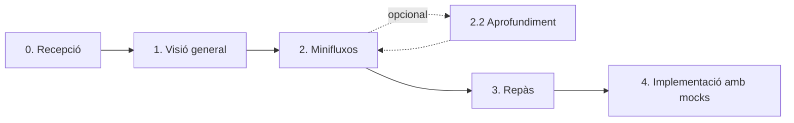

<div align="center">

# onboard-program


*A la faena t'han donat un programa i l'has d'entendre PER A AHIR...*

[](https://docs.claude.com/en/docs/claude-code/skills)
[](#)
[](#instal·lació)

[Español](README.md) · [English](README.en.md) · **Valencià**

</div>

**onboard-program** és una skill per a [Claude Code](https://docs.claude.com/en/docs/claude-code/overview) que acompanya un desenvolupador/a nou/nova, pas a pas, a comprendre un programa, servei o repositori que no coneix. Convertix el "no entenc este programa" en un recorregut guiat que va del general al concret i deixa al repositori documentació, diagrames, una llista de control i scripts executables amb dades simulades (*mocks*).

> [!NOTE]
> La skill en si (`SKILL.md` i les plantilles) està escrita en espanyol, així que la documentació generada pot eixir en espanyol. Si la vols en valencià, demana-li-ho a Claude quan comences.

## Contingut

- [Inici ràpid](#inici-ràpid)
- [Què obtens](#què-obtens)
- [Instal·lació](#instal·lació)
- [Ús](#ús)
- [Com funciona](#com-funciona)
- [Principis de disseny](#principis-de-disseny)
- [Estructura del repositori](#estructura-del-repositori)
- [Contribuir](#contribuir)

## Inici ràpid

```bash
git clone https://github.com/JorgePR91/onboard-program-skill-.git
mkdir -p ~/.claude/skills
cp -r onboard-program-skill-/onboard-program ~/.claude/skills/
```

Obri Claude Code al repositori que vols entendre i escriu: *"Vull entendre este programa"*.

## Què obtens

En acabar el recorregut, el repositori analitzat conté una carpeta `docs/onboarding/` com esta:

```
<repo-analitzat>/
└── docs/onboarding/
    ├── _progress.md                  ← estat de l'onboarding (per a reprendre'l)
    ├── checklist.md                  ← el teu tauler de progrés
    ├── 01-vision-general.md          ← què fa, què NO fa, com ho fa
    ├── 02-flujos/
    │   ├── 01-<flux-1>.md
    │   ├── 01-<flux-1>-detalle.md    ← només si has demanat aprofundir
    │   ├── 02-<flux-2>.md
    │   └── ...
    ├── 03-repaso.md                  ← dependències, patrons i riscos
    └── 04-implementacion-mocks/
        ├── run-01-<flux-1>.py        ← executa el codi real amb dades sintètiques
        ├── 01-<flux-1>-input.json
        ├── 01-<flux-1>-expected-output.md
        └── ...
```

Cada document inclou diagrames Mermaid (GitHub els mostra directament), referències `fitxer:línia` al codi i, quan cal, un glossari amb analogies quotidianes perquè no quede cap terme tècnic sense explicar.

> [!NOTE]
> En stacks compilats (Java, .NET, Go…), el driver de cada flux és un test dins de l'arbre de tests del projecte, en una carpeta `onboarding/`, i `run-NN-<flux>` només el llança. Claude et demana permís abans d'escriure fora de `docs/onboarding/`. En començar també et pregunta si vols versionar `docs/onboarding/` o afegir-la a `.gitignore`.

## Instal·lació

### Requisits

- [Claude Code](https://docs.claude.com/en/docs/claude-code/overview) instal·lat.
- Res més: no cal compilar ni instal·lar dependències.

### 1. Clona el repositori

```bash
git clone https://github.com/JorgePR91/onboard-program-skill-.git
cd onboard-program-skill-
```

### 2. Copia la skill al directori de skills d'usuari

**macOS / Linux**

```bash
mkdir -p ~/.claude/skills
cp -r onboard-program ~/.claude/skills/
```

**Windows (PowerShell)**

```powershell
New-Item -ItemType Directory -Force "$HOME\.claude\skills" | Out-Null
Copy-Item -Recurse .\onboard-program "$HOME\.claude\skills\"
```

El resultat ha de quedar així:

```
~/.claude/skills/onboard-program/
├── SKILL.md
├── templates/
└── evals/        ← casos de prova (opcional, no afecta l'ús)
```

### 3. Reinicia Claude Code

Obri (o reinicia) Claude Code perquè detecte la skill. Com que és una skill d'usuari, queda disponible en tots els teus projectes.

> [!TIP]
> **Només per a un projecte?** Copia-la a `.claude/skills/onboard-program/` dins d'eixe repositori i només estarà disponible allí (i per a qui clone el repositori).

### Actualitzar

```bash
cd onboard-program-skill-
git pull
cp -r onboard-program ~/.claude/skills/
```

En Windows, repetix el `Copy-Item` del pas 2 afegint `-Force`.

## Ús

Obri Claude Code al repositori que vols entendre i escriu alguna cosa com ara:

- *"Vull entendre este programa"*
- *"Onboarding d'este repositori"*
- *"Explica'm este codi pas a pas"*
- *"Presenta'm este servei"*
- *"Ajuda'm a comprendre què fa este codi"*

No cal dir la paraula "onboarding": la skill s'activa sempre que demanes comprendre o explorar un programa que no coneixes. Si no queda clar quin programa cal analitzar, Claude et demanarà la ruta.

**Reprendre-ho un altre dia.** L'estat es guarda a `docs/onboarding/_progress.md` dins del repositori analitzat. Si tanques la sessió i hi tornes més tard, Claude el llig i continua on ho havies deixat, sense repetir fases ni tornar a preguntar-te el que ja vas decidir. També guarda el commit analitzat: si el codi ha canviat des d'aleshores, t'avisa que les referències `fitxer:línia` poden haver-se desplaçat.

**Triar d'una llista llarga.** Quan hi ha més de quatre opcions (tecnologies, minifluxos, scripts), Claude et mostra una llista numerada i respons amb els números: `1, 3, 7`, `2-5`, `tots` o `cap`.

## Com funciona

El recorregut té quatre fases. Al final de cadascuna, Claude **s'atura i et pregunta** com continuar.



| Fase | Objectiu | Eixida |
|------|----------|--------|
| 0. Recepció | Comprovar si hi ha un onboarding a mitges i reprendre'l | Lectura de `_progress.md` |
| 1. Visió general | Què fa, què no fa i com està construït | `01-vision-general.md` + diagrama Mermaid |
| 2. Minifluxos | Recórrer les funcionalitats una a una, les que tu tries | `02-flujos/NN-<nom>.md` per flux |
| 2.2 Aprofundiment *(opcional)* | Funcions clau, fitxers implicats i aspectes transversals | `02-flujos/NN-<nom>-detalle.md` |
| 3. Repàs | Consolidar: dependències, patrons repetits i riscos | `03-repaso.md` |
| 4. Implementació amb mocks | Executar els fluxos sobre el codi real amb dades sintètiques | `04-implementacion-mocks/` |

<details>
<summary><strong>Detalls de cada fase</strong></summary>

- **La fase 1 s'adapta al teu nivell.** Claude detecta les tecnologies clau del programa (llenguatge, framework, base de dades, broker…) i et pregunta quines no domines. Només explica eixes, així no avorrix un perfil sènior ni deixa perdut un de júnior.
- **La fase 2 treballa per cicles.** Claude identifica *tots* els minifluxos (endpoints, ordres de CLI, jobs, esdeveniments consumits…), tu tries quins vols explorar i es documenten en tandes de fins a 4, amb una parada entre tandes. Cap flux triat es descarta sense que ho confirmes.
- **La fase 2 dona una eixida aproximada.** Cada miniflux inclou l'eixida que es deduïx llegint el codi, marcada com a aproximada. La fase 4 la verifica executant-lo i, si no coincidix, corregix el document.
- **La fase 4 també va per cicles, i demana confirmació abans d'executar.** Tries quins fluxos vols convertir en script. Abans d'executar cada tanda, Claude neutralitza la configuració que podria tocar sistemes reals (credencials, cadenes de connexió, URL de producció) i et demana permís. Els teus fitxers de configuració no es modifiquen.
- **Numeració estable.** Cada miniflux rep un número (`01`, `02`…) que no canvia encara que l'exploris en un altre ordre o en descartes d'altres. Eixe número apareix en tots els llocs on s'esmenta el flux: la llista inicial, `_progress.md`, noms de fitxer, títols, llista de control, repàs i scripts de la fase 4 (`run-NN-<flux>.<ext>`, `NN-<flux>-input.json`, `NN-<flux>-expected-output.md`). El flux `07` és sempre el `07`.

</details>

## Principis de disseny

**Dialogar, no abocar.** La skill mai no resol l'onboarding en un únic missatge gegant. Ningú no assimila quatre fases de colp, i només preguntant entre fases es pot saber quins fluxos t'interessen o on vols aprofundir. La llista de control té sentit perquè la vas marcant a mesura que avances.

**Mock mínim, codi real màxim.** Els scripts de la fase 4 **no reimplementen** els fluxos: són drivers prims que importen i invoquen el codi del mateix programa, el mateix que vas llegir en la fase 2. En concret:

- Només se simulen les fronteres d'E/S (xarxa, base de dades, cues, rellotge, aleatorietat…).
- Es preferix la invocació dins del procés quan el stack ho permet (`TestClient`, `MockMvc`, `supertest`, `WebApplicationFactory`…).
- Es reutilitzen els fixtures i helpers de test que ja tinga el repositori.
- Les dependències són les del mateix programa; els scripts no declaren un entorn paral·lel.
- L'eixida esperada s'obté d'una execució real de l'script, mai no s'escriu de memòria. Si l'script no es pot executar, es diu explícitament.

**Sense termes orfes.** Tot terme tècnic que aparega en la documentació està definit en algun lloc on el lector puga arribar, i els conceptes nous van acompanyats d'una analogia quotidiana.

## Estructura del repositori

```
.
├── README.md                  ← documentació en espanyol (no forma part de la skill)
├── README.en.md               ← documentació en anglés
├── README.ca.md               ← documentació en valencià
├── IMAGE.svg                  ← imatge del README
└── onboard-program/           ← la skill: esta és la carpeta que es copia
    ├── SKILL.md               ← instruccions per a Claude: què fer en cada fase
    ├── templates/             ← plantilles que Claude ompli en cada document
    │   ├── _progress.md
    │   ├── checklist.md
    │   ├── 01-vision-general.md
    │   ├── 02-flujo.md
    │   ├── 02-flujo-detalle.md
    │   ├── 03-repaso.md
    │   └── 04-expected-output.md
    └── evals/
        └── evals.json         ← casos de prova d'activació i comportament
```

### Skills complementàries

Si les tens instal·lades, la skill s'hi pot recolzar. No són obligatòries:

- `project-workflow-analysis-blueprint-generator`: per a detectar l'arquitectura i el stack amb més rigor en la fase 1.
- `test-data-generation`: per a generar dades simulades més realistes en la fase 4.

## Contribuir

Els suggeriments i les correccions són benvinguts:

- **Alguna cosa no ha funcionat com esperaves?** Obri una [issue](https://github.com/JorgePR91/onboard-program-skill-/issues) indicant què li vas demanar a Claude, què va fer i què esperaves que fera.
- **Vols proposar un canvi?** Fes un fork, crea una branca i obri un pull request. Si canvies el comportament de la skill en [`SKILL.md`](onboard-program/SKILL.md), afig o actualitza el cas corresponent en [`evals/evals.json`](onboard-program/evals/evals.json).
