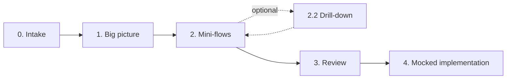

<div align="center">

# onboard-program


*They handed you a program at work and you needed to understand it YESTERDAY...*

[](https://docs.claude.com/en/docs/claude-code/skills)
[](#)
[](#installation)

[Español](README.md) · **English** · [Valencià](README.ca.md)

</div>

**onboard-program** is a [Claude Code](https://docs.claude.com/en/docs/claude-code/overview) skill that walks a new developer, step by step, through understanding a program, service or repository they don't know. It turns "I don't understand this program" into a guided tour that goes from the big picture to the details, and leaves documentation, diagrams, a checklist and runnable scripts with mocked data in the repo.

> [!NOTE]
> The skill itself (`SKILL.md` and its templates) is written in Spanish, so the generated documentation may come out in Spanish. If you want it in English, just ask Claude when you start.

## Contents

- [Quick start](#quick-start)
- [What you get](#what-you-get)
- [Installation](#installation)
- [Usage](#usage)
- [How it works](#how-it-works)
- [Design principles](#design-principles)
- [Repository structure](#repository-structure)
- [Contributing](#contributing)

## Quick start

```bash
git clone https://github.com/JorgePR91/onboard-program-skill-.git
mkdir -p ~/.claude/skills
cp -r onboard-program-skill-/onboard-program ~/.claude/skills/
```

Open Claude Code in the repository you want to understand and type: *"I want to understand this program"*.

## What you get

When the tour is over, the analysed repository contains a `docs/onboarding/` folder like this:

```
<analysed-repo>/
└── docs/onboarding/
    ├── _progress.md                  ← onboarding state (to resume it)
    ├── checklist.md                  ← your progress board
    ├── 01-vision-general.md          ← what it does, what it does NOT do, how it does it
    ├── 02-flujos/
    │   ├── 01-<flow-1>.md
    │   ├── 01-<flow-1>-detalle.md    ← only if you asked for a drill-down
    │   ├── 02-<flow-2>.md
    │   └── ...
    ├── 03-repaso.md                  ← dependencies, patterns and risks
    └── 04-implementacion-mocks/
        ├── run-01-<flow-1>.py        ← runs the real code with synthetic data
        ├── 01-<flow-1>-input.json
        ├── 01-<flow-1>-expected-output.md
        └── ...
```

Each document includes Mermaid diagrams (GitHub renders them natively), `file:line` references to the code and, when needed, a glossary with everyday analogies so no jargon is left unexplained.

> [!NOTE]
> In compiled stacks (Java, .NET, Go…), each flow's driver is a test inside the project's test tree, in an `onboarding/` folder, and `run-NN-<flow>` just launches it. Claude asks for permission before writing outside `docs/onboarding/`. At the start it also asks whether you want to version `docs/onboarding/` or add it to `.gitignore`.

## Installation

### Requirements

- [Claude Code](https://docs.claude.com/en/docs/claude-code/overview) installed.
- Nothing else: there is nothing to build and no dependencies to install.

### 1. Clone the repository

```bash
git clone https://github.com/JorgePR91/onboard-program-skill-.git
cd onboard-program-skill-
```

### 2. Copy the skill into your user skills directory

**macOS / Linux**

```bash
mkdir -p ~/.claude/skills
cp -r onboard-program ~/.claude/skills/
```

**Windows (PowerShell)**

```powershell
New-Item -ItemType Directory -Force "$HOME\.claude\skills" | Out-Null
Copy-Item -Recurse .\onboard-program "$HOME\.claude\skills\"
```

The result should look like this:

```
~/.claude/skills/onboard-program/
├── SKILL.md
├── templates/
└── evals/        ← test cases (optional, not needed to use the skill)
```

### 3. Restart Claude Code

Open (or restart) Claude Code so it picks up the skill. As a user skill, it is available in all your projects.

> [!TIP]
> **Only for one project?** Copy it into `.claude/skills/onboard-program/` inside that repository and it will only be available there (and to anyone who clones the repo).

### Updating

```bash
cd onboard-program-skill-
git pull
cp -r onboard-program ~/.claude/skills/
```

On Windows, repeat the `Copy-Item` from step 2 adding `-Force`.

## Usage

Open Claude Code in the repository you want to understand and type something like:

- *"I want to understand this program"*
- *"Onboarding for this repo"*
- *"Explain this code to me step by step"*
- *"Walk me through this service"*
- *"Help me understand what this code does"*

You don't need to say "onboarding": the skill kicks in whenever you ask to understand or explore a program you don't know. If it's not clear which program to analyse, Claude will ask you for the path.

**Pick up another day.** The state is saved in `docs/onboarding/_progress.md` inside the analysed repo. If you close the session and come back later, Claude reads it and continues where you left off, without repeating phases or asking again about what you already decided. It also records the analysed commit: if the code has changed since then, it warns you that the `file:line` references may have shifted.

**Choosing from a long list.** When there are more than four options (technologies, mini-flows, scripts), Claude shows a numbered list and you answer with the numbers: `1, 3, 7`, `2-5`, `all` or `none`.

## How it works

The tour has four phases. At the end of each one, Claude **stops and asks you** how to continue.



| Phase | Goal | Output |
|-------|------|--------|
| 0. Intake | Check whether there is an unfinished onboarding and resume it | Reads `_progress.md` |
| 1. Big picture | What it does, what it doesn't do and how it's built | `01-vision-general.md` + Mermaid diagram |
| 2. Mini-flows | Go through the features one by one, the ones you choose | `02-flujos/NN-<name>.md` per flow |
| 2.2 Drill-down *(optional)* | Key functions, files involved and cross-cutting concerns | `02-flujos/NN-<name>-detalle.md` |
| 3. Review | Consolidate: dependencies, recurring patterns and risks | `03-repaso.md` |
| 4. Mocked implementation | Run the flows on the real code with synthetic data | `04-implementacion-mocks/` |

<details>
<summary><strong>Phase details</strong></summary>

- **Phase 1 adapts to your level.** Claude detects the program's key technologies (language, framework, database, broker…) and asks which ones you aren't familiar with. It only explains those, so it doesn't bore a senior profile or leave a junior one lost.
- **Phase 2 works in cycles.** Claude identifies *all* the mini-flows (endpoints, CLI commands, jobs, consumed events…), you choose which ones to explore, and they are documented in batches of up to 4, with a stop between batches. No chosen flow is dropped without your confirmation.
- **Phase 2 gives an approximate output.** Each mini-flow includes the output inferred from reading the code, marked as approximate. Phase 4 verifies it by running it and, if it doesn't match, fixes the document.
- **Phase 4 also works in cycles, and asks for confirmation before running anything.** You choose which flows to turn into scripts. Before running each batch, Claude neutralises any configuration that could touch real systems (credentials, connection strings, production URLs) and asks for your permission. Your configuration files are not modified.
- **Stable numbering.** Each mini-flow gets a number (`01`, `02`…) that never changes, even if you explore it in a different order or drop others. That number appears everywhere the flow is mentioned: the initial list, `_progress.md`, file names, titles, checklist, review and the Phase 4 scripts (`run-NN-<flow>.<ext>`, `NN-<flow>-input.json`, `NN-<flow>-expected-output.md`). Flow `07` is always `07`.

</details>

## Design principles

**Talk, don't dump.** The skill never solves the onboarding in one giant message. Nobody takes in four phases at once, and only by asking between phases can it learn which flows interest you or where you want to dig deeper. The checklist makes sense because you tick it off as you go.

**Minimal mocks, maximum real code.** The Phase 4 scripts **do not reimplement** the flows: they are thin drivers that import and call the program's own code, the same code you read in Phase 2. Specifically:

- Only I/O boundaries are mocked (network, database, queues, clock, randomness…).
- In-process invocation is preferred when the stack allows it (`TestClient`, `MockMvc`, `supertest`, `WebApplicationFactory`…).
- Existing test fixtures and helpers in the repo are reused.
- Dependencies are the program's own; the scripts don't declare a parallel environment.
- The expected output comes from an actual run of the script, never written from memory. If the script can't be run, that is stated explicitly.

**No orphan jargon.** Every technical term that appears in the documentation is defined somewhere the reader can reach, and new concepts come with an everyday analogy.

## Repository structure

```
.
├── README.md                  ← documentation in Spanish (not part of the skill)
├── README.en.md               ← documentation in English
├── README.ca.md               ← documentation in Valencian Catalan
├── IMAGE.svg                  ← README image
└── onboard-program/           ← the skill: this is the folder you copy
    ├── SKILL.md               ← instructions for Claude: what to do in each phase
    ├── templates/             ← templates Claude fills in for each document
    │   ├── _progress.md
    │   ├── checklist.md
    │   ├── 01-vision-general.md
    │   ├── 02-flujo.md
    │   ├── 02-flujo-detalle.md
    │   ├── 03-repaso.md
    │   └── 04-expected-output.md
    └── evals/
        └── evals.json         ← activation and behaviour test cases
```

### Complementary skills

If you have them installed, the skill can lean on them. They are not required:

- `project-workflow-analysis-blueprint-generator`: to detect architecture and stack more rigorously in Phase 1.
- `test-data-generation`: to generate more realistic mocked data in Phase 4.

## Contributing

Suggestions and fixes are welcome:

- **Something didn't work as expected?** Open an [issue](https://github.com/JorgePR91/onboard-program-skill-/issues) describing what you asked Claude, what it did and what you expected it to do.
- **Want to propose a change?** Fork the repo, create a branch and open a pull request. If you change the skill's behaviour in [`SKILL.md`](onboard-program/SKILL.md), add or update the matching case in [`evals/evals.json`](onboard-program/evals/evals.json).
